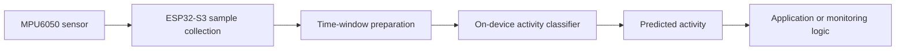

# High-Level Architecture

This diagram shows the public-facing system flow only. It intentionally omits private model internals, preprocessing details, training code, and dataset information.

The system is an experimental prototype. Real-world performance must be validated on the target hardware and under representative movement conditions.
